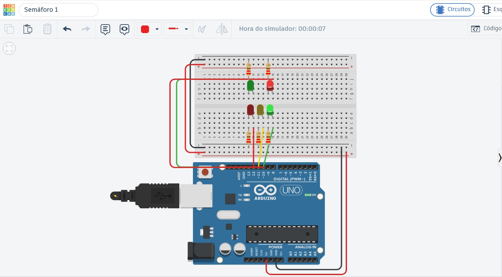

# semaforo-arduino
Simulação de um semáforo com Arduino Uno e cinco LEDS no Tinkercad

Simulei um semáfoto no Tinkercad usando um Arduino Uno e cinco LEDs. Na primeira versão, cada LED ficava aceso por 3 segundos. Na segunda, programei o verde para 4 segundos, o amarelo para 2 e o vermelho para 5. Na versão final, aceitei o desafio do professor e acrescentei 2 LEDs, onde o verde acende juntamente com o vermelho e vice e versa.
[Abrir a simulação no Tinkercad](https://www.tinkercad.com/things/fX2h9akm15N-semaforo-1?sharecode=Srj0GhIMwkCMevKkf7uUs8SyIEhb5Srh4WdxIIC5QfQ)

## Uso na escola

No 9º ano, eu usaria o semáforo nas aulas de Matemática para investigar uma pergunta do cotidiano dos estudantes: como o tempo de cada luz influencia a espera para atravessar a rua em frente à escola? Em grupos, os alunos observariam a simulação e cronometrariam cada fase. Depois, calculariam a duração do ciclo completo e a fração do ciclo em que o sinal fica vermelho para os carros. O desafio seria ampliar esse tempo de 5 para 6 segundos, mantendo o ciclo de 11 segundos. Cada grupo decidiria de qual fase retirar 1 segundo, testaria sua hipótese e explicaria a escolha. Assim, a turma trabalharia medidas de tempo, frações e argumentação a partir de uma decisão concreta. Para finalizar, também lançaria o mesmo desafio que o professor nos lançou. 
